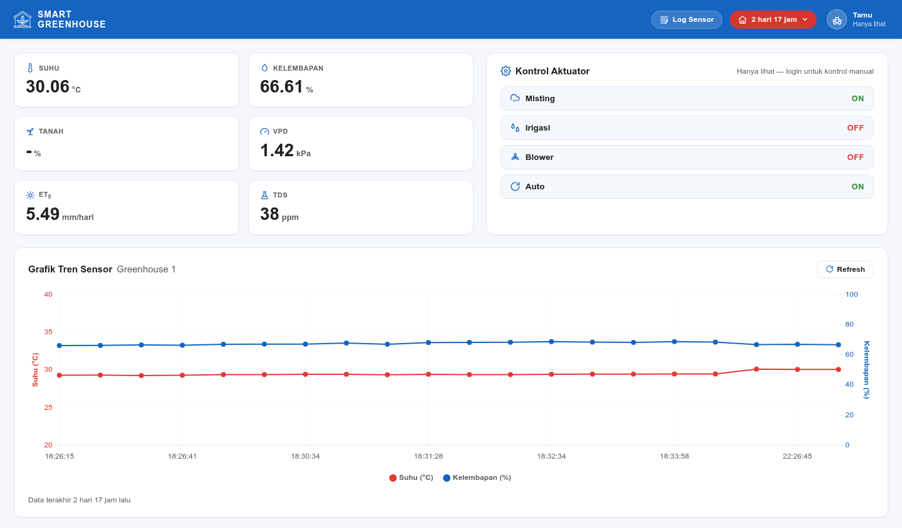
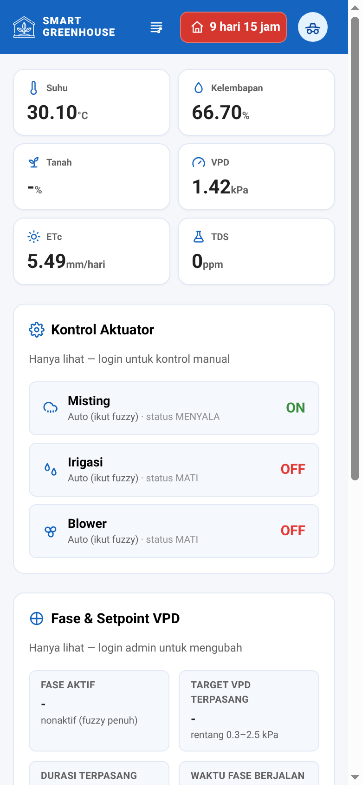
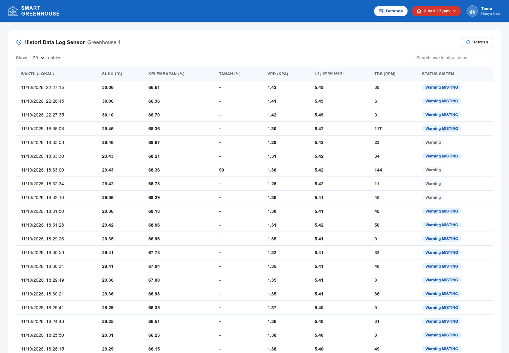
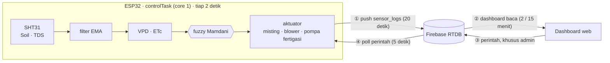

# Smart Greenhouse Dashboard

Sistem penyiram dan iklim otomatis untuk greenhouse cabai merah. ESP32 membaca
sensor, memutuskan tindakan lewat fuzzy logic, menggerakkan pompa, penyiram
kabut, dan kipas, lalu mengirim telemetri ke dashboard web melalui Firebase
Realtime Database.

## Tampilan



Layout: satu topbar biru solid, tanpa sidebar. Greenhouse yang dipantau dan
dikontrol dipilih lewat tombol di topbar — isi tombol itu **kapan data terakhir
masuk** (`2 hari 16 jam`), dan warnanya menandakan kondisi: hijau = data segar,
krem = basi kurang dari sehari atau jam perangkat belum sinkron, merah = basi
lebih dari sehari atau gagal dibaca. Krem itu memakai token peringatan yang
sama dengan pill di tabel log (`#fff8e1` dengan teks `#8a5200`, tepi `#ffe082`)
— sengaja bukan kuning menyala karena hue jenuh bertabrakan dengan biru topbar
dan teksnya jadi sulit dibaca. Navigasi cukup satu tombol **Log Sensor**:
klik membuka histori, klik lagi kembali ke Beranda. Seluruh tampilan mengikuti
satu skema warna (Material Blue berpusat di `#1565C0`) yang didefinisikan
sebagai token Tailwind di `web/src/style.css`; hijau dan merah diambil dari
warna ON/OFF aktuator, dan grafik membaca variabel warna yang sama.

**Beranda** menampilkan enam metrik dasar (suhu, kelembapan, kandungan air
tanah, VPD, ETc, dan TDS) dalam dua kolom × tiga baris, ditambah dua kartu air —
**Dosis harian** (dengan sisa anggaran hari ini) dan **Air terpakai** — yang
hanya muncul bila perangkat mengirim field irigasi. Kartu **Tanah** memuat satu
angka saja, yaitu rata-rata probe yang dipakai fuzzy, plus status probe
(`3/3 probe`, `2/3 probe`, atau `probe tidak terdeteksi`): angka per probe tidak
menambah informasi bagi operator, yang perlu terlihat adalah apakah semuanya
masih terbaca. Pada monitor lebar (≥ 900 px) kartu **Kontrol Aktuator** berdiri
tepat di sebelahnya, sedangkan kartu **Grafik Iklim** membentang penuh di bawah
keduanya; nama greenhouse yang dipantau menyambung di judul kartu, jadi tidak
lagi memakai chip terpisah. Grafik itu satu kartu dengan tiga sumbu — suhu,
kelembapan, dan VPD (sumbu kanan kedua) — serta pilihan rentang 6 jam / 24 jam
dan tombol Refresh. Target VPD tidak digambar karena angkanya sudah terbaca di
panel Fase & Setpoint, dan tidak ada grafik tanah atau air terpisah. Di ponsel
semuanya menjadi satu kolom: metrik → kontrol → grafik.

Kartu kontrol memuat satu baris per aktuator (Misting, Irigasi, Blower).
Posisi knob sakelar = perintah yang barusan dikirim: langsung bergerak saat
diklik, lalu menyesuaikan laporan perangkat pada record berikutnya. Warna track
hanya menandakan nyala/mati, sedangkan **mode override** — Auto (ikut fuzzy),
Paksa nyala, atau Paksa mati — dibawa teks di atasnya, jadi satu elemen tidak
mengangkut dua makna. Menyalakan sakelar berarti **paksa nyala**, mematikannya
berarti **paksa mati** (untuk irigasi: siklus yang sedang berjalan dibatalkan);
keduanya kedaluwarsa sendiri setelah 10 menit. Kembali ke fuzzy dilakukan lewat
tombol **Kembali ke Auto**, yang melepas override semua aktuator sekaligus.
Kartu ini terlihat untuk semua orang, tapi **sakelarnya hanya muncul setelah
login admin**.

Panel **Fase & Setpoint VPD** (target VPD, nama fase, durasi, reset
penghitung, nonaktifkan setpoint) hanya untuk admin, dan menampilkan nilai
yang diminta berdampingan dengan nilai yang sudah terpasang di perangkat.



**Log Sensor** menampilkan histori dalam tabel, lengkap dengan pilihan jumlah
baris (10/20/50) dan pencarian. Tampilan menyesuaikan lebar layar, dari ponsel
sampai monitor lebar. Di layar sempit tabel digeser mendatar, dan **kolom waktu
tetap menempel di kiri** supaya konteks tiap baris tidak ikut hilang.



Menambah unit greenhouse = tambah baris di `ZONES` (`web/public/config.js`) dengan
`id` yang sama dengan `DEVICE_ID` firmware, plus tambahkan UID perangkat itu ke
allowlist rules RTDB.

## Akses

Dashboard **terbuka untuk semua orang**: siapa pun bisa membuka halaman dan
melihat data sensor tanpa login, dan tampil sebagai **Tamu**. Untuk kendali
manual atau mengelola greenhouse, klik avatar **Tamu** → **Login**.

| Peran | Akun | Boleh |
|---|---|---|
| Tamu | tanpa akun | baca metrik, grafik, log, dan status aktuator |
| Admin | `mr.pman@mail.unnes.ac.id` | + sakelar kontrol aktuator & ganti nama greenhouse |
| Perangkat | satu akun per ESP32 | push sensor, terima perintah |

Status gangguan perangkat tampil sebagai badge di tabel log: `SOILERR` dan
`TDSERR` (sensor tidak terbaca), `NOSYNC` (jam perangkat belum sinkron), dan
`IRRIGOFF` — irigasi otomatis dimatikan perangkat sampai debit pompa
dikalibrasi, sementara perintah manual tetap jalan.

Field `status_sistem` dari perangkat berisi label aksi plus penanda gangguan di
ujungnya (`Misting + Blower ON TDSERR NOSYNC`). Dashboard memisahkan keduanya:
kolom status menampilkan label bersihnya, dan tiap penanda jadi badge sendiri —
tidak ada gangguan yang tercetak dua kali. Pencarian dan ekspor CSV tetap
membaca string mentah, jadi mengetik `TDSERR` masih menemukan barisnya.

Cukup dua jenis akun: **admin** dan **ESP32**. Tulis (kontrol & label) dijaga
RTDB rules lewat allowlist UID; pembacaan dibuka publik karena isinya hanya
telemetri. Detail & cara menempelkan rules ada di dokumen internal tim yang
tidak disertakan di repo ini.

Sesi admin disimpan di browser (`persistence: local`), jadi admin tetap login
otomatis sampai menekan **Keluar**. Tamu di perangkat lain tidak terpengaruh.

## Hardware

Mikrokontroler: ESP32 DevKit v1, framework Arduino via PlatformIO, dua task
FreeRTOS.

### Sensor

| Sensor | Antarmuka | Pin | Output |
| --- | --- | --- | --- |
| SHT31 (suhu dan kelembapan) | I2C `0x44` | SDA 21, SCL 22 | +/- 0.2 °C, +/- 2 % RH |
| Tiga probe soil kapasitif | Analog (ADC1) | GPIO 34 / 33 / 39 | 0-100 % (ADC terbalik) |
| TDS Meter v1.0 | Analog | GPIO 35 | 0-2000 ppm |

Ketiga probe dibaca bergantian (jeda 10 ms), lalu rata-rata probe yang **valid**
dipakai keputusan irigasi. Tiap probe tetap dilaporkan terpisah (`soil2`,
`soil3`) supaya polybag yang mengering lebih dulu kelihatan, dan statusnya
dikirim eksplisit sebagai bitmask `soil_ok` + jumlah probe `soil_n` — tanpa dua
field itu, probe yang tercabut tidak bisa dibedakan dari record firmware lama
karena nilai NaN dibuang dari JSON.

Semua pin analog wajib di **ADC1**. Selama WiFi aktif, ADC2 (GPIO 0, 2, 4,
12-15, 25-27) tidak bisa dipakai, jadi soil menempati 34/33/39 dan TDS 35;
GPIO 36 dikosongkan sebagai cadangan. GPIO 34, 35, dan 39 input-only, tanpa
pull-up internal.

### Aktuator

| Aktuator | Pin | Sinyal | Fungsi |
| --- | --- | --- | --- |
| Misting | GPIO 26 | Digital | Penyiram kabut |
| Blower (2 kipas paralel) | GPIO 25 | PWM 1 kHz, 8-bit | Ventilasi |
| Pompa FILL | GPIO 13 | Digital | Isi ember campuran, 12 V |
| Pompa FERT A | GPIO 14 | Digital | Pupuk A, 5 V |
| Pompa FERT B | GPIO 15 | Digital | Pupuk B, 5 V |
| Pompa DIST | GPIO 32 | Digital | Salur larutan ke tanaman, 12 V |

Setiap kanal lewat satu modul **XY-MOS 400 W** (umumnya aktif-HIGH; modul
aktif-LOW cukup dengan `MOSFET_INVERTED 1` di `config.h`). Hanya blower yang
benar-benar butuh PWM: XY-MOS punya spesifikasi 0-20 kHz dan pada 25 kHz kipas
hanya mau berputar di duty 100 %, sehingga LEDC disetel **1 kHz** dan kontrol
proporsional bekerja penuh. Kipas baru mulai berputar sekitar 20 % duty (mati di
~13 %), jadi level fuzzy di bawah itu dinaikkan ke `BLOWER_MIN_DUTY` (0,20)
sebelum ditulis ke PWM.

Debit terukur (gelas ukur + stopwatch, 3×, rata-rata): DIST 31,7 mL/s,
FERT 22,2 mL/s. Kalibrasi irigasi — debit, luas media, jumlah siklus per hari,
dan durasi tiap fase — ada di `firmware/src/config.h`; dosis dan durasi pompa
dihitung dari sana, bukan ditulis tetap. Durasi fase FILL, FERT, dan SETTLE
masih **perkiraan** dan ditandai `TODO` di `config.h` karena belum diukur di
lapangan.

### Catu daya dan pengkabelan

Dua PSU terpisah; outputnya jangan diparalel dan jangan digabung jadi satu.

| PSU | Beban | Margin |
| --- | --- | --- |
| 12 V 5 A | blower 0,6 A + misting 0,3 A + FILL + DIST (FILL dan DIST bergantian lewat state machine, worst-case realistis ~1,9 A) | ~2,6× |
| 5 V 2 A | ESP32, LCD + backlight, SHT31, TDS, 2 pompa dosing 0,2 A (~0,6-0,8 A) | ~2,5× |

- **GND kedua PSU disatukan di satu titik.** Input modul XY-MOS butuh referensi
  common; tanpa itu modul tidak terbaca sebagai HIGH/LOW yang jelas.
- ESP32 disuplai ke pin `VIN`/`5V`. Jangan `3V3` (AMS1117 onboard kepanasan)
  dan jangan 12 V.
- Star wiring dari terminal PSU, dengan fuse ~3 A di rail 12 V dan ~2 A di rail
  5 V. Elco 1000 µF di rail 12 V, 470-1000 µF di dekat input ESP, dan 100 nF di
  input modul kalau sinyalnya jitter.
- **Risiko brownout**: ESP berbagi rail 5 V dengan pompa dosing, jadi arus start
  pompa bisa menjatuhkan rail dan me-reset ESP. Mitigasi berurutan: (1) elco dan
  jalur 5 V sendiri ke ESP, (2) buck 12 V→5 V khusus ESP (MP1584/LM2596).
- SHT31 boleh 3,3 V; TDS dan LCD disuplai 5 V.
- Kabel analog soil dan TDS dijauhkan serta dipendekkan dari kabel motor 12 V —
  noise dari kabel pompa membuat bacaan ADC melompat.
- Modul microSD wajib 3,3 V (level sinyal SD 3,3 V), kartu format FAT32 maksimal
  32 GB. Tanpa modul, firmware tetap jalan dengan keterangan "lanjut tanpa
  backup".
- LCD 20×4: backlight nyala tetapi teks kosong = pot kontras, bukan library.

### Tambahan

LCD 20x4 (I2C `0x27`) dan MicroSD pada SPI (CS 5, SCK 18, MISO 19, MOSI 23)
sebagai backup log lokal.

Seluruh output digital mengikuti flag `MOSFET_INVERTED` di `config.h`, sehingga
modul XY-MOS aktif-LOW dapat dipakai tanpa mengubah kode.

## Cara kerja



Empat alur yang perlu diikuti: sensor dibaca dan aktuator diputuskan sepenuhnya
di ESP32 (tiap 2 detik), ESP32 mengunggah log sensor ke RTDB tiap 20 detik,
dashboard menariknya kembali, dan perintah admin dikirim lewat RTDB lalu
dieksekusi perangkat setiap 5 detik. Jalur ② dan ③ tetap melewati RTDB karena
itulah satu-satunya penghubung antara perangkat dan peramban.

Interval baca dashboard tidak tetap: mengikuti rentang grafik yang dipilih —
2 menit untuk 6 jam (1080 record) dan 15 menit untuk 24 jam (4320 record, ~2,6
MB sekali fetch). Polling berhenti saat tab tidak terlihat, supaya kuota Spark
tidak habis oleh dashboard yang ditinggal terbuka.

**Kontrol fuzzy.** Logika fuzzy Mamdani dengan membership function tripel untuk
suhu, kelembapan, tanah, VPD, dan ETc. Aturan disimpan sebagai tabel di
`fuzzy.cpp`; level 0 berarti "off" dan hanya menurunkan bobot.

**VPD dan ETc.** VPD dihitung dengan rumus Tetens (`calcVpd` di
`RumahHijau.ino`). ETc memakai metode Blaney-Criddle di `irrigation.cpp`: faktor
p = 0,266–0,284 per bulan (Tabel FAO-24 untuk lintang Semarang, ada di
`config.h`), Tmean = rata-rata suhu sliding 3 jam, dan Kc mengikuti fase
pertumbuhan (0,40 / 0,75 / 1,10 / 1,00 / 0,90). Angka p sebelumnya 0,48 berasal
dari tafsir rumus FAO-24, bukan dari tabelnya, dan melebih ETo sekitar 65%.

**Siklus irigasi.** Satu siklus berjalan lima fase berurutan:
`FILL → FERT → SETTLE → CHECK → DIST`.

| Fase | Pompa yang menyala | Apa yang terjadi |
|---|---|---|
| `FILL` | FILL | Ember campuran diisi dari penampungan utama. |
| `FERT` | FERT A dan B | Dosis pupuk A dan B masuk ke ember selama durasi tetap. |
| `SETTLE` | — | Semua pompa mati, larutan homogen sebelum dinilai. |
| `CHECK` | — | TDS ember dinilai terhadap rentang penerimaan. |
| `DIST` | DIST | Larutan dialirkan ke tanaman selama durasi dosis. |

Dosis per siklus bukan timer tetap: dihitung dari ETc harian
(ETc × luas media 9 000 cm² × 0,1), dibagi jumlah siklus per hari, lalu
dijadikan durasi pompa DIST lewat debit terukur 31,7 mL/s. Dosis stok A dan B
pada fase FERT berjalan **lingkaran terbuka**: durasinya tetap, dihitung dari
debit pompa FERT terukur 22,2 mL/s menurut resep AB Mix, bukan disesuaikan
terhadap bacaan TDS.

Karena itu TDS pada fase CHECK hanya **memverifikasi** dugaan dosis, bukan
mengendalikannya. Dua kasus dibedakan sengaja:

- **Larutan terbaca dan jelas di luar** `TDS_MIN_PPM`..`TDS_MAX_PPM` — kimianya
  salah, jadi distribusi **ditahan**: siklus dibatalkan, anggaran harian
  dikembalikan karena air tidak pernah sampai ke tanaman, dan alasannya dikirim
  lewat field `irigasi_alasan_tahan` di RTDB beserta label `TDSERR` pada status.
  Dashboard menampilkannya sebagai banner peringatan.
- **Probe tidak terbaca** (`tdsValid=false`, mis. probe dicabut) — bukan alasan
  menahan air. Tanpa probe, tanaman tidak akan pernah disiram, jadi larutan
  tetap dialirkan dan hanya diberi peringatan.

Volume harian dibatasi anggaran ETc dan antar siklus ada jeda minimum,
sehingga air yang keluar tidak melebihi kebutuhan tanaman. Durasi fase `FILL`,
`FERT`, dan `SETTLE` masih **perkiraan** dan ditandai `TODO` di `config.h`;
nilai sebenarnya diukur dari waktu yang tercetak di log serial pada tiap
perpindahan fase (`irigasi: fase FILL`, dst.).

**Fail-safe.** Bila sensor tidak valid, keputusan fuzzy untuk irigasi tidak
dipakai dan siklus irigasi yang sedang berjalan dibatalkan. Override manual
operator tetap berjalan karena itu perintah eksplisit — termasuk **paksa mati**,
yang membatalkan siklus irigasi yang sedang berjalan, bukan hanya mencegah
siklus baru. `controlTask` berlangganan Task WDT (diinisialisasi eksplisit,
timeout 5 detik), sehingga I2C yang macet memicu reboot alih-alih membiarkan
pompa menyala.

**Pembagian task.** `controlTask` di core 1 menjalankan sensor, fuzzy, dan
aktuator. `netTask` di core 0 menangani WiFi, token, push RTDB, dan poll
perintah. I/O jaringan yang blocking tidak pernah menahan jalur aktuator.

## Struktur

```text
firmware/src/     Firmware utama
web/              Dashboard (Vue 3 + Vite + Tailwind)
  src/store.js    State + fetch RTDB + auth (satu reactive())
  src/components/ 10 komponen: App, Metrics, Controls, PhasePanel, TrendChart,
                  LogTable, ZoneMenu, ZoneStatus, UserMenu, LoginModal
  public/         config.js + greenhouse.png (di-copy apa adanya ke dist/)
  dist/           Hasil `npm run build` (tidak di-commit)
```

## Menjalankan

Dashboard yang sedang live: **https://smartgh.capstone-26.workers.dev/**
(Cloudflare Workers dengan static assets). Terbuka untuk semua orang; sakelar
kendali dan ikon ganti nama unit hanya muncul setelah login admin.

```bash
cd firmware && pio run -t upload && pio device monitor
```

`firmware/src/secrets.h` tidak disertakan dalam repo. Salin dari
`secrets.h.example`, lalu isi SSID WiFi, API key Firebase, dan kredensial akun
perangkat.

Dashboard butuh Node.js (Vite) dan tidak bisa dibuka lewat `file://`. Salin
`web/config.js.example` ke `web/public/config.js`, lalu isi `firebaseConfig`,
`DB_URL`, dan `ZONES`.

```bash
cd web
npm install
npm run dev      # dev server + HMR  → http://localhost:5173
npm run build    # produksi → dist/ (yang di-deploy Cloudflare Workers, static assets)
npm run preview  # cek hasil build sebelum deploy
```

Karena memakai ES module, dashboard harus disajikan lewat HTTP — `npm run dev`
menangani ini. `ZONES` menambah satu unit greenhouse per baris.

## Lisensi

[GNU General Public License v2.0](LICENSE)