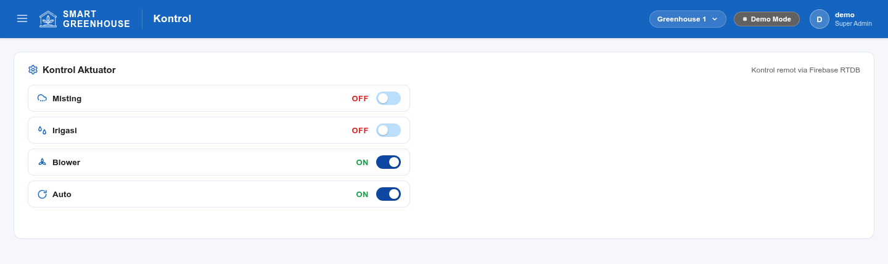

# Smart Greenhouse Dashboard

Sistem penyiram dan iklim otomatis untuk greenhouse cabai merah. ESP32 membaca
sensor, memutuskan tindakan lewat fuzzy logic, menggerakkan pompa, penyiram
kabut, dan kipas, lalu mengirim telemetri ke dashboard web melalui Firebase
Realtime Database.

## Tampilan


Layout admin: sidebar kiri (Beranda, Kontrol, Log Sensor) dan topbar biru solid.
Tombol hamburger menyembunyikan/munculkan sidebar di desktop, dan menjadi
drawer di layar kecil. Greenhouse yang dipantau/dikontrol dipilih lewat tombol
di topbar yang memunculkan daftar unit. Seluruh tampilan mengikuti satu skema
warna (Material Blue berpusat di `#1565C0`) yang didefinisikan di `style.css`;
grafik membaca variabel warna yang sama.

**Beranda** menampilkan enam metrik real-time (suhu, kelembapan, kandungan air
tanah, VPD, ET0, dan TDS) plus grafik tren 20 titik terakhir.

**Kontrol** menampilkan satu baris per aktuator (Misting, Irigasi, Blower,
Auto) dengan status ON/OFF dan sakelarnya, hanya untuk admin.



**Log Sensor** menampilkan histori dalam tabel, lengkap dengan pilihan jumlah
baris (10/20/50) dan pencarian. Tampilan menyesuaikan lebar layar, dari ponsel
sampai monitor lebar.

Menambah unit greenhouse = tambah baris di `ZONES` (`web/config.js`) dengan
`id` yang sama dengan `DEVICE_ID` firmware, plus tambahkan UID perangkat itu ke
allowlist rules RTDB.

## Hardware

Mikrokontroler: ESP32 DevKit v1, framework Arduino via PlatformIO, dua task
FreeRTOS.

### Sensor

| Sensor | Antarmuka | Pin | Output |
| --- | --- | --- | --- |
| SHT31 (suhu dan kelembapan) | I2C `0x44` | SDA 21, SCL 22 | +/- 0.2 °C, +/- 2 % RH |
| Soil moisture (kapasitif) | Analog | GPIO 34 | 0-100 % (ADC terbalik) |
| TDS Meter v1.0 | Analog | GPIO 35 | 0-2000 ppm |

### Aktuator

| Aktuator | Pin | Sinyal | Fungsi |
| --- | --- | --- | --- |
| Misting | GPIO 26 | Digital | Penyiram kabut |
| Blower (2 kipas paralel) | GPIO 25 | PWM 1 kHz, 8-bit | Ventilasi |
| Pompa FILL | GPIO 13 | Digital | Isi ember campuran, 12 V |
| Pompa FERT A | GPIO 14 | Digital | Pupuk A, 5 V |
| Pompa FERT B | GPIO 15 | Digital | Pupuk B, 5 V |
| Pompa DIST | GPIO 32 | Digital | Salur ke tanaman, 12 V |

### Tambahan

LCD 20x4 (I2C `0x27`) dan MicroSD pada SPI (CS 5, SCK 18, MISO 19, MOSI 23)
sebagai backup log lokal.

Seluruh output digital mengikuti flag `MOSFET_INVERTED` di `config.h`, sehingga
modul XY-MOS aktif-LOW dapat dipakai tanpa mengubah kode.

## Cara kerja

```text
Sensor (SHT31, soil, TDS)
 └─> Filter EMA ─> VPD, ETc ─> Fuzzy Mamdani ─> Aktuator
                                                      └─> Irigasi 4 pompa
                          -> Firebase RTDB <- Dashboard web
```

**Kontrol fuzzy.** Logika fuzzy Mamdani dengan membership function tripel untuk
suhu, kelembapan, tanah, VPD, dan ETc. Aturan disimpan sebagai tabel di
`fuzzy.cpp`; level 0 berarti "off" dan hanya menurunkan bobot.

**VPD dan ETc.** VPD dihitung dengan rumus Tetens di `vpd.cpp`. ETc memakai
metode Blaney-Criddle dengan Kc cabai 0.75 di `irrigation.cpp`.

**Siklus irigasi.** Berjalan tiga fase: FILL mengisi ember campuran, FERT
menyalakan kedua pompa fertilized dalam pola denyut 2 detik dan jeda 1 detik
sampai TDS mencapai 1000 ppm, lalu DIST mengalirkan campuran ke tanaman. Fase
FERT punya timeout keamanan 120 detik agar tidak berjalan terus.

**Fail-safe.** Bila sensor tidak valid, seluruh aktuator dimatikan dan siklus
irigasi yang sedang berjalan dibatalkan. `controlTask` berlangganan Task WDT,
sehingga I2C yang macet memicu reboot alih-alih membiarkan pompa menyala.

**Pembagian task.** `controlTask` di core 1 menjalankan sensor, fuzzy, dan
aktuator. `netTask` di core 0 menangani WiFi, token, push RTDB, dan poll
perintah. I/O jaringan yang blocking tidak pernah menahan jalur aktuator.

## Struktur

```text
firmware/src/     Firmware utama, 27 file
firmware_old/     Arsip pra-FreeRTOS, tidak lagi dipakai
web/              Dashboard statis: index.html, app.js, config.js, style.css
```

## Menjalankan

```bash
cd firmware && pio run -t upload && pio device monitor
```

`firmware/src/secrets.h` tidak disertakan dalam repo. Salin dari
`secrets.h.example`, lalu isi SSID WiFi, API key Firebase, dan kredensial akun
perangkat.

Dashboard membutuhkan HTTP server, bukan dibuka langsung lewat `file://`,
karena memakai modul Firebase. Salin `web/config.js.example` ke `web/config.js`
lalu isi `firebaseConfig` dan `DB_URL`.

## Lisensi

[GNU General Public License v2.0](LICENSE)